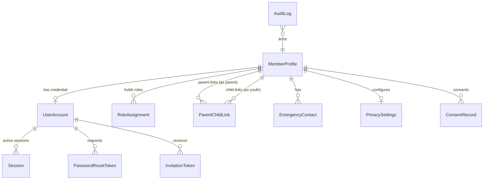

# Data Model: Phase 1 (Auth, RBAC & Member Profiles)

**Date**: 2026-10-25  
**Feature**: `specs/001-user-auth-rbac`

---

## 1. Relational Entity-Relationship Diagram



---

## 2. Model Definitions & Prisma Schema Specification

### 2.1 Enums

```prisma
enum Role {
  ADMIN
  COACH
  AD_HOC_COACH
  PLAYER
  PARENT
}

enum AccountStatus {
  ACTIVE
  INVITED
  LOCKED
  DEACTIVATED
}

enum BattingPosition {
  OPENING_BATTER
  TOP_ORDER
  MIDDLE_ORDER
  FINISHER
  TAILENDER
}

enum BowlingStyle {
  RIGHT_ARM_FAST
  RIGHT_ARM_MEDIUM
  LEFT_ARM_FAST
  LEFT_ARM_MEDIUM
  OFF_SPIN
  LEG_SPIN
  LEFT_ARM_ORTHODOX
  LEFT_ARM_WRIST_SPIN
  DOES_NOT_BOWL
}

enum SecondaryRole {
  WICKETKEEPER
  ALL_ROUNDER
}

enum ApparelSize {
  YOUTH_XXS
  YOUTH_XS
  YOUTH_S
  YOUTH_M
  YOUTH_L
  YOUTH_XL
  ADULT_S
  ADULT_M
  ADULT_L
  ADULT_XL
  ADULT_XXL
  ADULT_XXXL
}
```

---

### 2.2 Core Models

#### `MemberProfile`
Represents the human member of Roskilde Cricket Club. Exists independently of login credentials.

| Field | Type | Attributes | Description |
| :--- | :--- | :--- | :--- |
| `id` | `String` (UUID) | `@id @default(uuid())` | Primary identifier. |
| `firstName` | `String` | | First name. |
| `lastName` | `String` | | Last name. |
| `dateOfBirth` | `DateTime?` | | Required for `PLAYER` role to compute age & minor status. |
| `email` | `String?` | `@unique` | Personal contact email (optional for youth without credentials). |
| `phone` | `String?` | | Personal mobile phone number. |
| `address` | `String?` | | Residential street address. |
| `city` | `String?` | | City / Postal area. |
| `postalCode` | `String?` | | Postal code. |
| `battingPosition`| `BattingPosition?` | | Preferred batting position. |
| `bowlingStyle` | `BowlingStyle?` | | Primary bowling style. |
| `secondaryRoles`| `SecondaryRole[]` | | Array of secondary roles (e.g. Wicketkeeper). |
| `shirtSize` | `ApparelSize?` | | Official club shirt size. |
| `trouserSize` | `ApparelSize?` | | Official club trouser size. |
| `capSize` | `ApparelSize?` | | Official club cap size. |
| `isAnonymized` | `Boolean` | `@default(false)` | True when GDPR account deletion has purged personal data. |
| `createdAt` | `DateTime` | `@default(now())` | Creation timestamp (UTC). |
| `updatedAt` | `DateTime` | `@updatedAt` | Last modification timestamp (UTC). |

---

#### `UserAccount`
Represents authentication credentials for a member. Youth under 13 have no `UserAccount`.

| Field | Type | Attributes | Description |
| :--- | :--- | :--- | :--- |
| `id` | `String` (UUID) | `@id @default(uuid())` | Primary identifier. |
| `memberProfileId`| `String` | `@unique` | Foreign key to `MemberProfile`. |
| `email` | `String` | `@unique` | Login email identifier (must match `MemberProfile.email`). |
| `passwordHash` | `String` | | Argon2id password hash. |
| `status` | `AccountStatus` | `@default(INVITED)` | Current account access status. |
| `mustResetPassword` | `Boolean` | `@default(true)` | Guard flag forcing password reset on next login. |
| `temporaryPasswordExpiresAt` | `DateTime?` | | Expiration timestamp for CSPRNG temporary password (7 days). |
| `failedLoginAttempts` | `Int` | `@default(0)` | Counter for consecutive failed logins. |
| `lockedUntil` | `DateTime?` | | Lockout timestamp if failedLoginAttempts >= 5 (15 min). |
| `sessionVersion` | `Int` | `@default(1)` | Incremented upon "Sign out everywhere" or password change. |
| `createdAt` | `DateTime` | `@default(now())` | Account creation timestamp. |
| `updatedAt` | `DateTime` | `@updatedAt` | Modification timestamp. |

---

#### `RoleAssignment`
Join model supporting compound roles across the 5 predefined roles.

| Field | Type | Attributes | Description |
| :--- | :--- | :--- | :--- |
| `id` | `String` (UUID) | `@id @default(uuid())` | Primary identifier. |
| `memberProfileId`| `String` | | Foreign key to `MemberProfile`. |
| `role` | `Role` | | Assigned role (`ADMIN`, `COACH`, `AD_HOC_COACH`, `PLAYER`, `PARENT`). |
| `assignedAt` | `DateTime` | `@default(now())` | Timestamp of assignment. |
| `assignedById` | `String?` | | Admin `MemberProfile.id` who granted the role. |

- **Constraints**: `@@unique([memberProfileId, role])`.

---

#### `ParentChildLink`
Links Parent-role members to youth Player profiles. Strictly capped at 2 parents per youth.

| Field | Type | Attributes | Description |
| :--- | :--- | :--- | :--- |
| `id` | `String` (UUID) | `@id @default(uuid())` | Primary identifier. |
| `playerId` | `String` | | Foreign key to `MemberProfile` (the youth player). |
| `parentId` | `String` | | Foreign key to `MemberProfile` (the parent). |
| `slot` | `Int` | | Parent slot index (allowed values: `1` or `2`). |
| `relationship` | `String?` | | Optional label (e.g., "Father", "Mother", "Guardian"). |
| `createdAt` | `DateTime` | `@default(now())` | Link creation timestamp. |

- **Constraints**:
  - `@@unique([playerId, slot])`: Enforces maximum 2 parents per youth at database level.
  - `@@unique([playerId, parentId])`: Prevents duplicate links for the same parent-player pair.

---

#### `Session`
Database-backed sessions supporting concurrent multi-device logins and instant revocation.

| Field | Type | Attributes | Description |
| :--- | :--- | :--- | :--- |
| `id` | `String` (UUID) | `@id @default(uuid())` | Primary identifier. |
| `sessionToken` | `String` | `@unique` | Secure CSPRNG token stored in HttpOnly cookie. |
| `userAccountId` | `String` | | Foreign key to `UserAccount`. |
| `userAgent` | `String?` | | Client device identifier string (browser/mobile). |
| `ipAddress` | `String?` | | Client IP address at login. |
| `expiresAt` | `DateTime` | | Expiry timestamp (sliding 30 days). |
| `createdAt` | `DateTime` | `@default(now())` | Creation timestamp. |

---

#### `EmergencyContact`
Emergency contact for a player or member.

| Field | Type | Attributes | Description |
| :--- | :--- | :--- | :--- |
| `id` | `String` (UUID) | `@id @default(uuid())` | Primary identifier. |
| `memberProfileId`| `String` | | Foreign key to `MemberProfile`. |
| `name` | `String` | | Contact full name. |
| `relationship` | `String` | | Relationship (e.g., Mother, Father, Spouse). |
| `phone` | `String` | | Direct telephone number. |
| `isPrimary` | `Boolean` | `@default(true)` | Primary emergency contact indicator. |

---

#### `PrivacySettings`
Per-member directory visibility toggles. Defaults to hidden (`false`) for GDPR compliance.

| Field | Type | Attributes | Description |
| :--- | :--- | :--- | :--- |
| `id` | `String` (UUID) | `@id @default(uuid())` | Primary identifier. |
| `memberProfileId`| `String` | `@unique` | Foreign key to `MemberProfile`. |
| `showEmailInDirectory` | `Boolean` | `@default(false)` | Directory visibility toggle for email. |
| `showPhoneInDirectory` | `Boolean` | `@default(false)` | Directory visibility toggle for phone. |
| `showAddressInDirectory`| `Boolean` | `@default(false)` | Directory visibility toggle for physical address. |

---

#### `ConsentRecord`
Tracks explicit GDPR privacy policy consent.

| Field | Type | Attributes | Description |
| :--- | :--- | :--- | :--- |
| `id` | `String` (UUID) | `@id @default(uuid())` | Primary identifier. |
| `subjectProfileId` | `String` | | Member profile the consent applies to. |
| `consentedById` | `String` | | User account / profile who provided consent (parent if minor). |
| `policyVersion` | `String` | | e.g. "1.0.0". |
| `consentedAt` | `DateTime` | `@default(now())` | Timestamp of consent. |
| `ipAddress` | `String?` | | Client IP at consent. |

---

#### `AuditLog`
Immutable audit log recording sensitive security and administrative mutations.

| Field | Type | Attributes | Description |
| :--- | :--- | :--- | :--- |
| `id` | `String` (UUID) | `@id @default(uuid())` | Primary identifier. |
| `actorProfileId` | `String?` | | Profile ID of the user performing the action. |
| `targetProfileId`| `String?` | | Subject profile ID. |
| `action` | `String` | | e.g. `ROLE_ASSIGNED`, `PASSWORD_RESET`, `DELEGATED_UPDATE`, `MEMBER_ANONYMIZED`. |
| `metadata` | `Json?` | | Context payload (e.g. before/after values, changed fields). |
| `createdAt` | `DateTime` | `@default(now())` | Timestamp of action. |

---

## 3. Data Integrity & Invariants

1. **Age & Credential Guard**:
   - `UserAccount` cannot be created if `MemberProfile.dateOfBirth` indicates age < 13.
2. **Minor Role Assignment Guard**:
   - If `MemberProfile.dateOfBirth` indicates age < 18, `RoleAssignment.role` MUST be strictly `PLAYER`.
3. **Database-Enforced 2-Parent Cap**:
   - `ParentChildLink(playerId, slot)` unique constraint limits `slot` to 1 or 2.
4. **Anonymization Invariant**:
   - When `MemberProfile.isAnonymized == true`, `firstName` = "Former", `lastName` = "Member #[short-id]", and `email`, `phone`, `address`, `emergencyContacts` are NULL or deleted. `UserAccount` and `Session` records are deleted.
