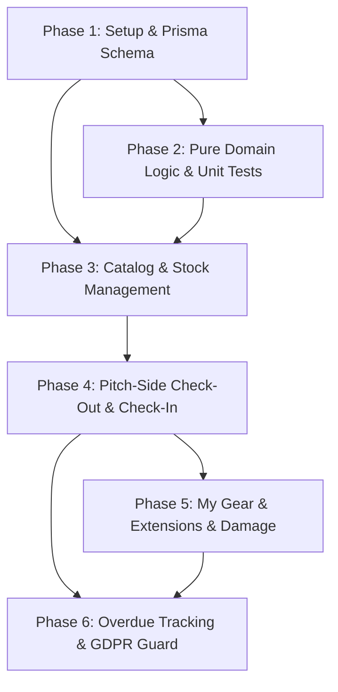

# Tasks: Club Inventory & Equipment Management

**Branch**: `002-inventory-equipment-management`  
**Date**: 2026-10-25  
**Spec**: [specs/002-inventory-equipment-management/spec.md](file:///Users/shishirjain/p/s/roskilde-cricket-app/specs/002-inventory-equipment-management/spec.md)  
**Plan**: [specs/002-inventory-equipment-management/plan.md](file:///Users/shishirjain/p/s/roskilde-cricket-app/specs/002-inventory-equipment-management/plan.md)  
**Status**: Ready for Implementation  

---

## Phase 1: Setup & Prisma Schema Migration

**Goal**: Establish the relational data schema for all equipment items, loans, stock ledger transactions, loan extensions, and damage reports; generate Prisma client types and provide realistic seed data.

- [X] T001 Define Module 2 Enums (`TrackingType`, `EquipmentCategory`, `AgeGroup`, `ItemCondition`, `ItemStatus`, `LoanStatus`, `StockTransactionType`, `ExtensionStatus`, `DamageReportStatus`) and Models (`EquipmentItem`, `EquipmentLoan`, `StockTransaction`, `EquipmentLoanExtension`, `EquipmentDamageReport`) with `MemberProfile` relation fields in `prisma/schema.prisma`
- [X] T002 Create and execute Prisma migration `add_inventory_equipment_module` and regenerate Prisma client via `npx prisma generate`
- [X] T003 [P] Create realistic club inventory seed script in `scripts/seed-inventory.ts` seeding serialized match bats (`BAT-2026-001`, `BAT-2026-002`), Masuri helmets, BOLA bowling machine, facility shed keys, and bulk match balls/cones/bibs with purchase prices in integer øre
- [X] T004 [P] Add seed execution script `seed:inventory` in `package.json`

**Checkpoint**: Database schema migrated and validated; sample club inventory seeded.

---

## Phase 2: Pure Domain Logic & Unit Tests

**Goal**: Implement framework-agnostic, zero-dependency pure TypeScript business rules for equipment state transitions, stock math, category return deadline defaults, and 24-hour reminder cooldowns.

- [X] T005 [P] Implement `src/modules/inventory/domain/equipment-state-machine.ts` with valid state transitions (`AVAILABLE`, `ON_LOAN`, `UNDER_MAINTENANCE`, `RETIRED`), role authorizations, and terminal `RETIRED` state invariants
- [X] T006 [P] Implement unit tests in `tests/unit/inventory/equipment-state-machine.test.ts` covering allowed transitions, damaged returns, maintenance completions, and rejection of forbidden/terminal moves
- [X] T007 [P] Implement `src/modules/inventory/domain/stock-math.ts` with serialized vs. bulk stock arithmetic, `RETURNABLE_LOAN` decrements/replenishments, `DIRECT_CONSUMPTION` total/available decrements, and low-stock threshold triggers
- [X] T008 [P] Implement unit tests in `tests/unit/inventory/stock-math.test.ts` covering consumable consumption, return restocking, partial bulk returns, and write-offs
- [X] T009 [P] Implement `src/modules/inventory/domain/return-deadline.ts` with category-based default return calculators (Same-Day 23:59 for `FACILITY_KEYS` and match balls; +7 days for `BATTING`/`PROTECTIVE`/`TRAINING_GROUND`; end-of-season/+180 days for `APPAREL_KIT` and Coach kit bags)
- [X] T010 [P] Implement unit tests in `tests/unit/inventory/return-deadline.test.ts` covering each equipment category and custom date overrides
- [X] T011 [P] Implement `src/modules/inventory/domain/overdue-evaluator.ts` evaluating overdue conditions and enforcing the 24-hour notification cooldown guard
- [X] T012 [P] Implement unit tests in `tests/unit/inventory/overdue-evaluator.test.ts` verifying overdue detection and cooldown suppression (<24h vs >=24h)

**Checkpoint**: All domain unit tests passing with 100% pure function coverage (`npm run test:unit`).

---

## Phase 3: Equipment Catalog Management & Stock Adjustments

**Goal**: Provide Administrators and Coaches with a high-performance inventory console to view, filter, create, update, restock, and directly consume club equipment.

- [X] T013 [P] Define Zod validation schemas for catalog CRUD and stock operations in `src/modules/inventory/contracts/catalog.contract.ts` and `src/modules/inventory/contracts/stock.contract.ts`
- [X] T014 Implement catalog query and mutation service in `src/modules/inventory/services/catalog.service.ts` supporting category/condition/status filtering and øre-to-DKK display formatting
- [X] T015 Implement bulk stock adjustment and consumption service in `src/modules/inventory/services/stock.service.ts` managing `StockTransaction` audit records for direct match-day consumption and restocking
- [X] T016 Implement Server Actions for catalog CRUD and stock operations in `src/modules/inventory/actions/catalog.actions.ts` and `src/modules/inventory/actions/stock.actions.ts` with RBAC session validation
- [X] T017 [P] Build filterable catalog data table in `src/components/inventory/catalog-table.tsx` with search input, category tabs, condition badges, and low-stock indicators
- [X] T018 Build inventory master console page in `src/app/(dashboard)/inventory/page.tsx` and asset creation page in `src/app/(dashboard)/inventory/new/page.tsx`
- [X] T019 Build item detail, edit, and history view in `src/app/(dashboard)/inventory/[id]/page.tsx` including bulk stock adjustment and consumption modal dialogs

**Checkpoint**: Administrators and coaches can search/filter inventory (<500ms), create assets, adjust bulk counts, and log direct match-day consumption.

---

## Phase 4: Pitch-Side Check-Out & Check-In Workflows

**Goal**: Deliver mobile-first pitch-side checkout and return flows completable in <30 seconds on a 360 px viewport, with youth-to-parent accountability and damage routing.

- [X] T020 [P] Define Zod validation schemas for checkout and check-in operations in `src/modules/inventory/contracts/loan.contract.ts`
- [X] T021 Implement checkout and check-in transaction service in `src/modules/inventory/services/loan.service.ts` enforcing at most 1 active loan per serialized asset, pre-populating category return deadlines, dispatching checkout notices to linked parents for minors, and routing damaged returns to `UNDER_MAINTENANCE`
- [X] T022 Implement Server Actions in `src/modules/inventory/actions/loan.actions.ts` (`checkoutEquipmentAction`, `checkinEquipmentAction`)
- [X] T023 [P] Build mobile-responsive pitch-side checkout form component in `src/components/inventory/pitchside-checkout-form.tsx` with predictive asset search, minor borrower parent indicators, and return deadline pre-population
- [X] T024 [P] Build mobile-responsive pitch-side check-in form component in `src/components/inventory/pitchside-checkin-form.tsx` with condition assessment selector (`GOOD`, `FAIR`, `NEEDS_REPAIR`) and damage note prompt
- [X] T025 Build dedicated pitch-side checkout route in `src/app/(dashboard)/inventory/checkout/page.tsx` and return route in `src/app/(dashboard)/inventory/checkin/page.tsx`

**Checkpoint**: Pitch-side check-out and check-in workflow fully verified on mobile viewport (<30 seconds); youth loans bind parental responsibility.

---

## Phase 5: Personal "My Gear" Dashboard, Extension Requests & Damage Reporting

**Goal**: Allow all registered members (and parents via active profile switching) to view loaned equipment, submit 1-click extension requests, and report damaged/lost gear.

- [X] T026 [P] Define Zod validation schemas for extension requests and damage reports in `src/modules/inventory/contracts/extension.contract.ts` and `src/modules/inventory/contracts/damage.contract.ts`
- [X] T027 Implement extension and damage services in `src/modules/inventory/services/extension.service.ts` and `src/modules/inventory/services/damage.service.ts` supporting member submission, parent delegation, and administrative review
- [X] T028 Implement Server Actions in `src/modules/inventory/actions/extension.actions.ts` and `src/modules/inventory/actions/damage.actions.ts`
- [X] T029 [P] Build "My Gear" loan card and active items list in `src/components/inventory/my-gear-card.tsx` with "Request Extension" modal and "Report Damage / Loss" dialog
- [X] T030 Build "My Gear" member dashboard in `src/app/(dashboard)/profile/gear/page.tsx` integrated with `HeaderProfileSwitcher` context for linked youth
- [X] T031 Build administrative review queues in `src/app/(dashboard)/inventory/extensions/page.tsx` (1-click approval/rejection) and `src/app/(dashboard)/inventory/damage/page.tsx` (damage incident resolution referencing replacement cost in øre/DKK)

**Checkpoint**: Members and parents can manage loaned gear; extension requests can be approved with 1-click; damage reports can be logged and resolved.

---

## Phase 6: Overdue Tracking, Dual-Parent Escalation & GDPR Erasure Guard

**Goal**: Automate overdue return reminders with 24-hour notification cooldowns, dispatch simultaneous notices to linked parents, and prevent GDPR account deletion if active loans exist.

- [X] T032 [P] Implement reminder evaluation and dispatch service in `src/modules/inventory/services/reminder.service.ts` identifying overdue loans, checking the 24-hour cooldown, and sending dual-parent emails via `NotificationService`
- [X] T033 Implement Server Action in `src/modules/inventory/actions/reminder.actions.ts` for on-demand console reminder dispatch
- [X] T034 Build secured Route Handler in `src/app/api/inventory/cron/overdue/route.ts` with `Bearer ${CRON_SECRET}` authentication for automated daily scheduled execution
- [X] T035 Implement cross-module GDPR guard in `src/modules/inventory/services/inventory-gdpr.service.ts` checking for active or overdue loans on target members and their linked minor children
- [X] T036 Integrate `hasActiveOrOverdueLoans()` into `src/modules/auth-rbac/services/gdpr-deletion.service.ts` to block GDPR erasure when outstanding equipment exists, while retaining historical returned loans on the `"Former Member #..."` shell
- [X] T037 [P] Implement unit tests in `tests/unit/inventory/inventory-gdpr-guard.test.ts` verifying erasure blocking on active loans and success on returned loans
- [X] T038 Execute full verification gate across the entire codebase (`npx tsc --noEmit`, `npm run test:unit`, and `npm run build`)

**Checkpoint**: Overdue escalation automated with 24h cooldown; GDPR Article 17 guard protects club assets; entire application builds cleanly.

---

## Dependencies & Execution Order

### Phase Progression Rules
- **Phase 1 (Setup)**: Must complete first to provide database models and Prisma client.
- **Phase 2 (Domain)**: Pure domain functions and unit tests must be completed and passing before building dependent services.
- **Phase 3 (Catalog)**: Creates the core inventory management views, catalog table, and bulk consumption flows.
- **Phase 4 (Check-Out/Check-In)**: Implements mobile pitch-side workflows using the catalog models and state machine.
- **Phase 5 (My Gear)**: Builds self-service member/parent borrowing dashboard and extension/damage workflows.
- **Phase 6 (Overdue & GDPR)**: Ties together automated reminders, dual-parent escalation, and GDPR deletion guards.
