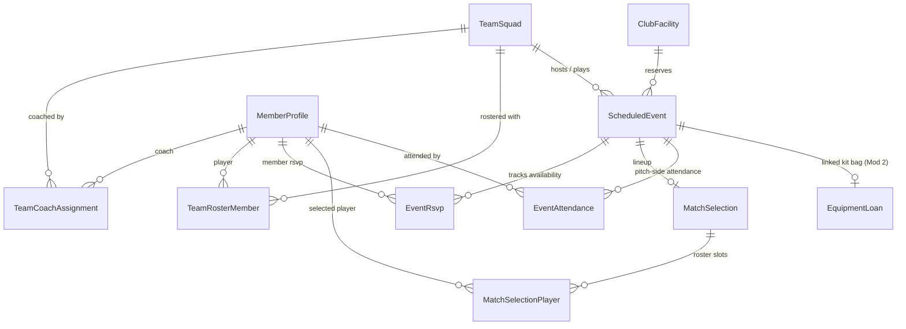

# Data Model: Teams, Squads, Training & Match Scheduling

**Feature Branch**: `003-teams-matches-scheduling`  
**Date**: 2026-10-25  
**Module**: Module 3 / Module 4 Domains (`src/modules/teams-matches/`)

---

## 1. Schema Overview

The teams and match scheduling domain requires 9 interconnected models backed by strict database enums and relational integrity rules, maintaining strict adherence to Constitution Principles I, II, and IV.



---

## 2. Enums

```prisma
enum SquadCategory {
  SENIOR
  YOUTH
  SOCIAL
}

enum SquadStaffRole {
  HEAD_COACH
  ASSISTANT_COACH
  AD_HOC_COACH
}

enum RosterRole {
  PLAYER
  CAPTAIN
  VICE_CAPTAIN
}

enum FacilityType {
  MAIN_PITCH
  PRACTICE_NETS
  INDOOR_HALL
  CLUBHOUSE
}

enum EventType {
  MATCH
  TRAINING
}

enum MatchType {
  LEAGUE
  FRIENDLY
  CUP
  TOURNAMENT
}

enum TrainingType {
  NET_PRACTICE
  FIELDING_FITNESS
  INDOOR_WINTER
  OPEN_NETS
}

enum EventLifecycleStatus {
  SCHEDULED
  PLAYED
  RAINED_OUT
  CANCELLED
}

enum RsvpStatus {
  NO_RESPONSE
  AVAILABLE
  UNAVAILABLE
  MAYBE
}

enum SelectionPublicationStatus {
  DRAFT
  PUBLISHED
}

enum LineupSlot {
  STARTING
  SUBSTITUTE
  RESERVE
}

enum MatchTacticalRole {
  PLAYER
  CAPTAIN
  VICE_CAPTAIN
  WICKETKEEPER
}

enum AttendanceStatus {
  PRESENT
  LATE
  ABSENT_EXCUSED
  NO_SHOW
}
```

---

## 3. Prisma Models

```prisma
model TeamSquad {
  id                 String               @id @default(uuid())
  name               String               @unique
  category           SquadCategory
  ageGroupRule       String?              // "U13", "U15", "U17", "OPEN"
  defaultLineupSize  Int                  @default(11)
  genderGroup        String               @default("MIXED") // "MENS", "WOMENS", "MIXED"
  description        String?
  isActive           Boolean              @default(true)
  createdAt          DateTime             @default(now())
  updatedAt          DateTime             @updatedAt

  coachAssignments   TeamCoachAssignment[]
  roster             TeamRosterMember[]
  scheduledEvents    ScheduledEvent[]

  @@index([category, isActive])
}

model TeamCoachAssignment {
  id              String          @id @default(uuid())
  teamSquadId     String
  coachProfileId  String
  role            SquadStaffRole  @default(HEAD_COACH)
  assignedAt      DateTime        @default(now())

  teamSquad       TeamSquad       @relation(fields: [teamSquadId], references: [id], onDelete: Cascade)
  coachProfile    MemberProfile   @relation(fields: [coachProfileId], references: [id], onDelete: Restrict)

  @@unique([teamSquadId, coachProfileId])
  @@index([coachProfileId])
}

model TeamRosterMember {
  id                 String          @id @default(uuid())
  teamSquadId        String
  memberProfileId    String
  rosterRole         RosterRole      @default(PLAYER)
  jerseyNumber       Int?
  hasDispensation    Boolean         @default(false)
  dispensationNotes  String?
  joinedAt           DateTime        @default(now())
  isActive           Boolean         @default(true)

  teamSquad          TeamSquad       @relation(fields: [teamSquadId], references: [id], onDelete: Cascade)
  memberProfile      MemberProfile   @relation(fields: [memberProfileId], references: [id], onDelete: Restrict)

  @@unique([teamSquadId, memberProfileId])
  @@index([memberProfileId, isActive])
}

model ClubFacility {
  id             String          @id @default(uuid())
  name           String          @unique
  facilityType   FacilityType
  location       String?
  capacity       Int?
  isActive       Boolean         @default(true)
  createdAt      DateTime        @default(now())
  updatedAt      DateTime        @updatedAt

  scheduledEvents ScheduledEvent[]

  @@index([facilityType, isActive])
}

model ScheduledEvent {
  id                      String                @id @default(uuid())
  teamSquadId             String
  facilityId              String?
  eventType               EventType
  matchType               MatchType?
  trainingType            TrainingType?
  title                   String
  date                    DateTime
  meetAt                  DateTime?
  startAt                 DateTime
  endAt                   DateTime
  isHome                  Boolean               @default(true)
  opponentName            String?
  venueName               String?
  venueAddress            String?
  rsvpDeadlineAt          DateTime
  targetLineupSize        Int                   @default(11)
  lifecycleStatus         EventLifecycleStatus  @default(SCHEDULED)
  scorecardUrl            String?
  collisionOverrideById   String?
  collisionOverrideReason String?
  collisionOverrideAt     DateTime?
  linkedEquipmentLoanId   String?
  createdById             String
  createdAt               DateTime              @default(now())
  updatedAt               DateTime              @updatedAt

  teamSquad               TeamSquad             @relation(fields: [teamSquadId], references: [id], onDelete: Restrict)
  facility                ClubFacility?         @relation(fields: [facilityId], references: [id], onDelete: SetNull)
  collisionOverrideBy     MemberProfile?        @relation("EventCollisionOverrides", fields: [collisionOverrideById], references: [id], onDelete: SetNull)
  createdBy               MemberProfile         @relation("EventCreators", fields: [createdById], references: [id], onDelete: Restrict)
  linkedEquipmentLoan     EquipmentLoan?        @relation("EventKitLoans", fields: [linkedEquipmentLoanId], references: [id], onDelete: SetNull)

  rsvps                   EventRsvp[]
  matchSelection          MatchSelection?
  attendances             EventAttendance[]

  @@index([facilityId, startAt, endAt])
  @@index([teamSquadId, date])
  @@index([startAt, lifecycleStatus])
}

model EventRsvp {
  id                String          @id @default(uuid())
  scheduledEventId  String
  memberProfileId   String
  submittedById     String
  status            RsvpStatus      @default(NO_RESPONSE)
  transportNote     String?
  submittedAt       DateTime        @default(now())
  updatedAt         DateTime        @updatedAt

  scheduledEvent    ScheduledEvent  @relation(fields: [scheduledEventId], references: [id], onDelete: Cascade)
  memberProfile     MemberProfile   @relation("MemberRsvps", fields: [memberProfileId], references: [id], onDelete: Restrict)
  submittedBy       MemberProfile   @relation("RsvpSubmitters", fields: [submittedById], references: [id], onDelete: Restrict)

  @@unique([scheduledEventId, memberProfileId])
  @@index([memberProfileId, status])
}

model MatchSelection {
  id                 String                     @id @default(uuid())
  scheduledEventId   String                     @unique
  selectionStatus    SelectionPublicationStatus @default(DRAFT)
  targetLineupSize   Int                        @default(11)
  publishedAt        DateTime?
  publishedById      String?
  notes              String?
  createdAt          DateTime                   @default(now())
  updatedAt          DateTime                   @updatedAt

  scheduledEvent     ScheduledEvent             @relation(fields: [scheduledEventId], references: [id], onDelete: Cascade)
  publishedBy        MemberProfile?             @relation("LineupPublishers", fields: [publishedById], references: [id], onDelete: SetNull)
  selectedPlayers    MatchSelectionPlayer[]

  @@index([selectionStatus])
}

model MatchSelectionPlayer {
  id                   String             @id @default(uuid())
  matchSelectionId     String
  memberProfileId      String
  selectionRole        LineupSlot         @default(STARTING)
  tacticalRole         MatchTacticalRole  @default(PLAYER)
  battingOrderPosition Int?
  createdAt            DateTime           @default(now())

  matchSelection       MatchSelection     @relation(fields: [matchSelectionId], references: [id], onDelete: Cascade)
  memberProfile        MemberProfile      @relation("SelectedMatchPlayers", fields: [memberProfileId], references: [id], onDelete: Restrict)

  @@unique([matchSelectionId, memberProfileId])
  @@index([memberProfileId])
}

model EventAttendance {
  id                String            @id @default(uuid())
  scheduledEventId  String
  memberProfileId   String
  status            AttendanceStatus  @default(PRESENT)
  arrivalTime       DateTime?
  notes             String?
  recordedById      String
  recordedAt        DateTime          @default(now())
  isLocked          Boolean           @default(false)
  lockedAt          DateTime?

  scheduledEvent    ScheduledEvent    @relation(fields: [scheduledEventId], references: [id], onDelete: Cascade)
  memberProfile     MemberProfile     @relation("MemberAttendances", fields: [memberProfileId], references: [id], onDelete: Restrict)
  recordedBy        MemberProfile     @relation("AttendanceRecorders", fields: [recordedById], references: [id], onDelete: Restrict)

  @@unique([scheduledEventId, memberProfileId])
  @@index([memberProfileId, status])
  @@index([scheduledEventId, isLocked])
}
```

---

## 4. Updates to Existing Models

### Updates to `MemberProfile`
Add back-relations for Module 3 entities:
```prisma
// Inside model MemberProfile:
  coachAssignments        TeamCoachAssignment[]
  rosterMemberships       TeamRosterMember[]
  eventsCreated           ScheduledEvent[]          @relation("EventCreators")
  eventCollisionOverrides ScheduledEvent[]          @relation("EventCollisionOverrides")
  rsvps                   EventRsvp[]               @relation("MemberRsvps")
  rsvpsSubmitted          EventRsvp[]               @relation("RsvpSubmitters")
  publishedLineups        MatchSelection[]          @relation("LineupPublishers")
  matchSelections         MatchSelectionPlayer[]    @relation("SelectedMatchPlayers")
  attendances             EventAttendance[]         @relation("MemberAttendances")
  attendancesRecorded     EventAttendance[]         @relation("AttendanceRecorders")
```

### Updates to `EquipmentLoan` (Module 2 linkage)
```prisma
// Inside model EquipmentLoan:
  linkedEvents            ScheduledEvent[]          @relation("EventKitLoans")
```

---

## 5. GDPR Article 17 Anonymization & Data Export Integrity

When an account is scrubbed into `"Former Member #..."`:
1. `EventRsvp.transportNote` is scrubbed to `NULL`.
2. `EventAttendance.notes` is scrubbed to `NULL`.
3. All relational rows (`MatchSelectionPlayer`, `EventAttendance`, `TeamRosterMember`) are **preserved** with the `memberProfileId` pointing to the anonymized record, ensuring match appearance counts, municipal reporting, and historical records remain statistically intact.
