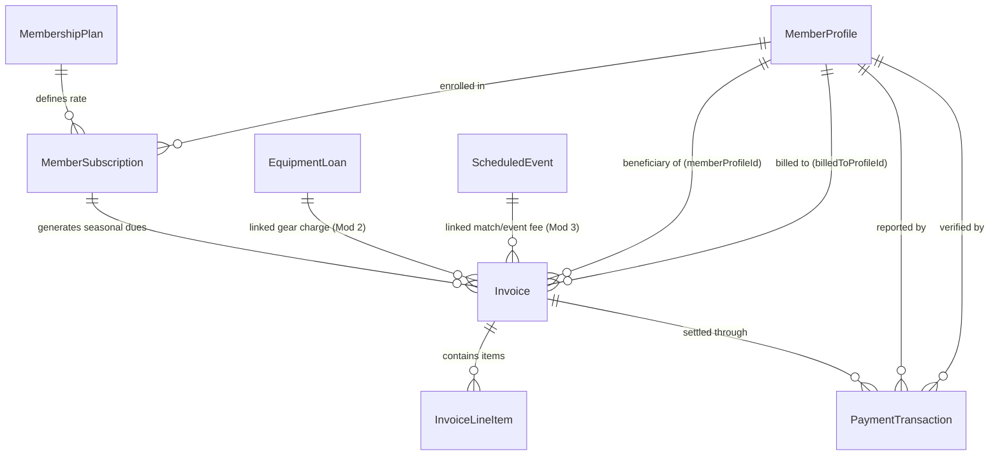

# Data Model: Membership Subscriptions, Club Fees & Finance

**Feature Branch**: `004-membership-fees-finance`  
**Date**: 2026-10-27  
**Module**: Module 4 Finance Domain (`src/modules/finance/`)

---

## 1. Schema Overview & Entity Relationships

The club finance and subscription domain comprises 5 core models backed by strict database enums, integer minor units (`øre`), and relational integrity constraints adhering to Constitution Principles I, II, and IV.



---

## 2. Enums

```prisma
enum MembershipCategory {
  SENIOR_COMPETITIVE
  YOUTH_U15_U13
  SOCIAL_PASSIVE
  INDOOR_WINTER_ADDON
}

enum BillingCycle {
  ANNUAL
  SUMMER_OUTDOOR
  WINTER_INDOOR
}

enum SubscriptionStatus {
  ACTIVE
  PENDING_PAYMENT
  EXPIRED
  CANCELLED
}

enum InvoiceCategory {
  MEMBERSHIP_DUES
  EVENT_FEE
  EQUIPMENT_CHARGE
  AD_HOC
}

enum InvoiceStatus {
  DRAFT
  OPEN
  PENDING_VERIFICATION
  PARTIALLY_PAID
  PAID
  OVERDUE
  WAIVED
  CANCELLED
}

enum PaymentMethod {
  MOBILEPAY
  BANK_TRANSFER
  CASH
  WAIVER_CREDIT
}

enum TransactionStatus {
  REPORTED
  VERIFIED
  REJECTED
}
```

---

## 3. Prisma Models

### 3.1 MembershipPlan
Defines club subscription tiers, standard fees in integer øre, and sibling discount percentages.

```prisma
model MembershipPlan {
  id                     String             @id @default(uuid())
  code                   String             @unique
  name                   String
  category               MembershipCategory
  billingCycle           BillingCycle
  amountOere             Int                // Integer minor units (100 øre = 1.00 DKK)
  siblingDiscountPercent Int                @default(25)
  description            String?
  isActive               Boolean            @default(true)
  createdAt              DateTime           @default(now())
  updatedAt              DateTime           @updatedAt

  subscriptions MemberSubscription[]

  @@index([category, isActive])
  @@index([billingCycle])
}
```

### 3.2 MemberSubscription
Represents an individual member's seasonal subscription enrollment, recording the base rate, automated sibling discount deduction, and optional manual Treasurer override.

```prisma
model MemberSubscription {
  id                  String             @id @default(uuid())
  memberProfileId     String
  planId              String
  seasonYear          Int                // e.g. 2026
  seasonCycle         BillingCycle
  startDate           DateTime
  endDate             DateTime
  status              SubscriptionStatus @default(PENDING_PAYMENT)
  hasSiblingDiscount  Boolean            @default(false)
  siblingDiscountOere Int                @default(0)
  manualDiscountOere  Int?
  overrideById        String?
  overrideReason      String?
  finalFeeOere        Int                // Final calculated fee in øre
  createdAt           DateTime           @default(now())
  updatedAt           DateTime           @updatedAt

  memberProfile MemberProfile   @relation("MemberSubscriptions", fields: [memberProfileId], references: [id], onDelete: Restrict)
  plan          MembershipPlan  @relation(fields: [planId], references: [id], onDelete: Restrict)
  overrideBy    MemberProfile?  @relation("SubscriptionDiscountOverrides", fields: [overrideById], references: [id], onDelete: SetNull)
  invoices      Invoice[]

  @@unique([memberProfileId, planId, seasonYear, seasonCycle])
  @@index([memberProfileId, status])
  @@index([seasonYear, seasonCycle])
}
```

### 3.3 Invoice
Represents a billing statement issued to an adult player or parent/guardian for minor children. Features deterministic human-readable reference numbers (`RCC-INV-YYYY-####`) for MobilePay/bank transfer reconciliation.

```prisma
model Invoice {
  id                     String          @id @default(uuid())
  invoiceNumber          String          @unique // e.g. "RCC-INV-2026-0001"
  paymentReference       String          @unique // Same as invoiceNumber for 1-to-1 payment matching
  memberProfileId        String          // Beneficiary member receiving club services
  billedToProfileId      String          // Debtor/Parent profile responsible for payment
  subscriptionId         String?         // Optional link to MemberSubscription
  category               InvoiceCategory @default(MEMBERSHIP_DUES)
  status                 InvoiceStatus   @default(OPEN)
  subtotalOere           Int
  discountOere           Int             @default(0)
  totalOere              Int
  paidOere               Int             @default(0)
  issueDate              DateTime        @default(now())
  dueDate                DateTime
  paidAt                 DateTime?
  lastReminderSentAt     DateTime?
  reminderCount          Int             @default(0)
  notes                  String?         // Scrubbed during GDPR Article 17 anonymization
  linkedEquipmentLoanId  String?         // Module 2 Equipment Loan link
  linkedScheduledEventId String?         // Module 3 Scheduled Event link
  createdAt              DateTime        @default(now())
  updatedAt              DateTime        @updatedAt

  memberProfile        MemberProfile        @relation("InvoicesReceived", fields: [memberProfileId], references: [id], onDelete: Restrict)
  billedToProfile      MemberProfile        @relation("InvoicesBilled", fields: [billedToProfileId], references: [id], onDelete: Restrict)
  subscription         MemberSubscription?  @relation(fields: [subscriptionId], references: [id], onDelete: SetNull)
  lineItems            InvoiceLineItem[]
  transactions         PaymentTransaction[]
  linkedEquipmentLoan  EquipmentLoan?       @relation("EquipmentLoanInvoices", fields: [linkedEquipmentLoanId], references: [id], onDelete: SetNull)
  linkedScheduledEvent ScheduledEvent?      @relation("ScheduledEventInvoices", fields: [linkedScheduledEventId], references: [id], onDelete: SetNull)

  @@index([billedToProfileId, status])
  @@index([memberProfileId, status])
  @@index([dueDate, status])
  @@index([category, status])
}
```

### 3.4 InvoiceLineItem
Itemized line-item charges on an invoice.

```prisma
model InvoiceLineItem {
  id            String   @id @default(uuid())
  invoiceId     String
  description   String
  quantity      Int      @default(1)
  unitPriceOere Int
  totalOere     Int
  createdAt     DateTime @default(now())

  invoice Invoice @relation(fields: [invoiceId], references: [id], onDelete: Cascade)

  @@index([invoiceId])
}
```

### 3.5 PaymentTransaction
Audit-ready record of a payment transaction (member self-reported and Treasurer verified).

```prisma
model PaymentTransaction {
  id                   String            @id @default(uuid())
  invoiceId            String
  reportedById         String            // Member/Parent who self-reported payment
  verifiedById         String?           // Treasurer/Admin who verified in reconciliation queue
  amountOere           Int
  paymentMethod        PaymentMethod
  status               TransactionStatus @default(REPORTED)
  transactionReference String?           // e.g. MobilePay transaction ID; scrubbed on GDPR erasure
  reportedAt           DateTime          @default(now())
  verifiedAt           DateTime?
  settlementDate       DateTime
  notes                String?           // Internal note; scrubbed on GDPR erasure

  invoice    Invoice        @relation(fields: [invoiceId], references: [id], onDelete: Cascade)
  reportedBy MemberProfile  @relation("PaymentsReported", fields: [reportedById], references: [id], onDelete: Restrict)
  verifiedBy MemberProfile? @relation("PaymentsVerified", fields: [verifiedById], references: [id], onDelete: SetNull)

  @@index([invoiceId, status])
  @@index([reportedById])
  @@index([settlementDate])
}
```

---

## 4. Reverse Relations on Existing Models

### Updates to `MemberProfile` in `prisma/schema.prisma`
```prisma
  // Module 4: Membership Subscriptions, Club Fees & Finance Relations
  subscriptions            MemberSubscription[] @relation("MemberSubscriptions")
  subscriptionOverrides    MemberSubscription[] @relation("SubscriptionDiscountOverrides")
  invoicesReceived         Invoice[]            @relation("InvoicesReceived")
  invoicesBilled           Invoice[]            @relation("InvoicesBilled")
  paymentsReported         PaymentTransaction[] @relation("PaymentsReported")
  paymentsVerified         PaymentTransaction[] @relation("PaymentsVerified")
```

### Updates to `EquipmentLoan` in `prisma/schema.prisma` (Module 2)
```prisma
  // Module 4: Finance link for unreturned/damaged gear replacement charges
  adHocInvoices Invoice[] @relation("EquipmentLoanInvoices")
```

### Updates to `ScheduledEvent` in `prisma/schema.prisma` (Module 3)
```prisma
  // Module 4: Finance link for tournament/match entry fees
  adHocInvoices Invoice[] @relation("ScheduledEventInvoices")
```
